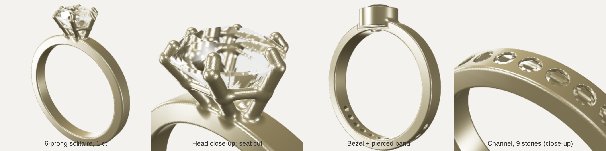

# RingForge

**A ring design studio with its own 3D geometry engine.**

> 🚧 Work in progress. Open Source Software term project, Fall 2026. Planned release: December 5, 2026.

RingForge designs rings that can actually be made: choose a size, a profile, a surface
pattern and a gemstone setting, see the ring in 3D, get its metal weight, cost and stone
carat, and export a watertight STL file for 3D printing or wax casting. It can also merge
two reference ring photos into a new design.

## Planned features

- Own geometry engine: signed distance fields + marching cubes, watertight STL export
- Gemstones: round brilliant stones with automatic seat cutting; prong, bezel and channel settings
- Ring sizes (US / Korean 호 / JP / mm), metal weight and cost, stone carat
- Pattern studio: grooves, hammered, Voronoi, engraved text, image relief
- `.ring` recipe language for sharing designs
- Merge and evolve designs; merge two reference photos into a new ring
- Thickness heatmap for manufacturability
- Web interface with live 3D preview

## Status

See [PROGRESS.md](PROGRESS.md) for the current stage and plan, and
[RingForge_Proposal.pdf](RingForge_Proposal.pdf) for the full proposal.
Early experiments are kept in [`prototypes/`](prototypes/).

## AI assistance

This project is developed with the help of Claude (Anthropic) as a coding assistant.
All AI-assisted work is disclosed here and in commit messages. I review and test all code.

## References

To be completed as the project grows. Prior art: JewelCraft (Blender add-on, GPL-3; no
code used), OpenSCAD, build123d. Algorithms: Lorensen & Cline (1987) marching cubes;
Tolkowsky (1919) diamond proportions.

## License

MIT, see [LICENSE](LICENSE).
