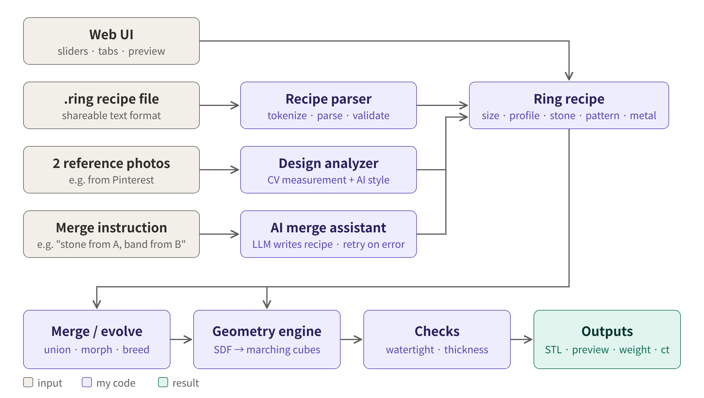
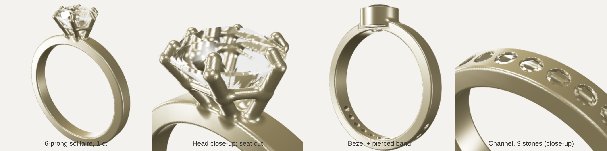
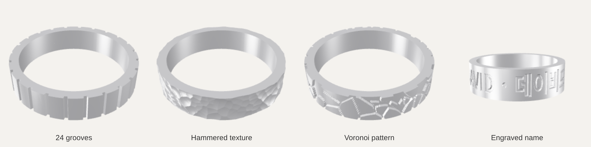
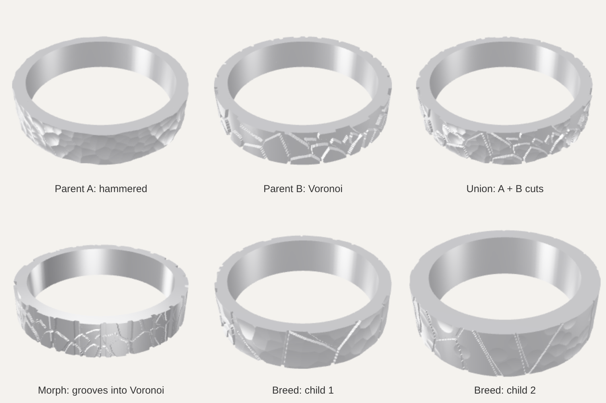

# RingForge

**A ring design studio with its own 3D geometry engine**

Term Project Proposal, version 2 · Open Source Software (Fall 2026)

| | |
|---|---|
| **Author** | David Khegay (Student ID: ____________ ) |
| **Type** | Individual project |
| **Version** | v2, November 9, 2026 (v1: October 28, 2026) |
| **Repository** | https://github.com/davidkhegay1/ringforge |
| **Deadline** | December 6, 2026 (planned submission: December 5) |
| **License** | MIT |

---

## What changed in v2

The professor approved the idea and asked for **gemstone support** to reach a good grade. This version:

- **Adds gemstones and settings:** round brilliant stones in prong, bezel and channel settings, with automatic stone seats and carat estimates. A working prototype is shown in Section 6.
- **Replaces the geometry engine:** height maps could not represent stones, prongs or holes, so the engine now uses **signed distance fields (SDF) + marching cubes**. Height-map patterns still work on top of it.
- **Adds an AI merge assistant:** the user describes in plain language how two designs should be merged, and the AI writes a ring recipe that RingForge validates before building.
- **Revises the scope and schedule:** AR try-on and the mesh optimizer are cut; couple rings and ring size from photo become optional. The feature freeze moves to November 26.

---

## 1. Summary

RingForge is an open-source web app for designing rings that can actually be made. You choose a size, a profile, a surface pattern and a gemstone setting, and RingForge shows the ring in 3D, calculates its metal weight, cost and stone carat, and exports a watertight STL file ready for 3D printing or wax casting.

Three things make it different from a simple "3D model generator":

1. **Everything geometric runs on my own engine.** Signed distance fields, marching cubes, gem polyhedra, stone seat cutting, volume calculation, watertight checking and the STL writer are written from scratch. No CAD library does the core work.
2. **It can merge two reference photos into a new design.** A user uploads two ring photos (for example from Pinterest), including rings with stones. RingForge analyzes each design and builds a new ring that is a real, printable file in the user's size.
3. **It understands merge instructions in plain language.** "Take the stone from ring A and the hammered band from ring B, 2 mm wide" becomes a validated design.

---

## 2. Motivation

- **Custom rings are popular, but hard to design.** Engagement rings, couple rings and name rings are common gifts, but designing one usually needs professional jewelry CAD software, which is expensive and takes a long time to learn.
- **Inspiration doesn't turn into a design file.** People save ring photos they like, but there is no simple way to go from "I like these two rings" to "here is a ring I can print."
- **Makers need numbers before casting.** Metal weight, cost and stone carat depend on volumes and densities, and are tedious to estimate by hand.
- **General CAD tools don't know about jewelry.** They will happily export a ring with a 0.3 mm wall that cracks, or a stone seat the stone cannot sit in.

From a computer science point of view, this one real problem connects many topics: computational geometry, implicit surfaces, procedural generation, parsing, ray casting, computer vision, genetic algorithms, and validating the output of a language model.

---

## 3. Originality

I went through the full lists of term projects from 2021 to 2025 (**575 projects**):

- **0 projects** deal with jewelry, gemstones, fabrication, or designing physical objects.
- Only about **6 projects** involve 3D graphics at all (e.g. *Blender object generator* 2021, *3D Icon Composer* 2025, *Vulkan Study* 2025), and none of them produce manufacturable models.
- RingForge avoids the most repeated categories: classic game clones (~35), chat bots (~34), to-do lists and timers (~31), and price prediction (~26).

Outside the class, the closest open-source tool is **JewelCraft**, a Blender add-on for gems, prongs and cutters (GPL-3). It requires learning Blender. General-purpose CAD tools (OpenSCAD, build123d) require programming or CAD skills. RingForge is a standalone web app made specifically for rings, and adds what those tools don't have: photo-based design merging, merging by plain-language instruction, interactive design evolution, and jewelry-specific manufacturability checks. No code from JewelCraft is used.

---

## 4. Features

| # | Feature | What it does | CS technique |
|---|---|---|---|
| 1 | **Geometry engine** (core) | Turns a ring description into a watertight triangle mesh; computes exact volume; writes binary STL | Signed distance fields, own marching cubes, signed-tetrahedron volume, edge-manifold check |
| 2 | **Gemstones & settings** (core) | Round brilliant stones in prong, bezel and channel settings; automatic stone seats; light holes and pierced bands; carat estimate | Convex polyhedra, CSG with SDF (min / max / smooth-min) |
| 3 | **Size & metal calculator** | Converts US / Korean (호) / Japanese / mm sizes to inner diameter; metal weight and cost; stone carat | Unit modeling, input validation |
| 4 | **Pattern studio** | Grooves, hammered texture, Voronoi cells, waves, engraved Korean or English text | Procedural generation, Voronoi diagrams, height maps applied to an SDF |
| 5 | **Image → ring** | Turns a fingerprint, drawing or photo into a relief on the ring | Image processing, brightness-to-depth mapping |
| 6 | **Ring recipe language** | A small text format (`.ring` files) that fully describes a design and can be shared or versioned with Git | Tokenizer, parser, interpreter, error reporting with line numbers |
| 7 | **Merge & evolve** | Combines two designs (union, morph, breed); interactive evolution where the user picks a favorite out of 6 children and breeds again | Genetic algorithms (crossover, mutation), interactive evolution |
| 8 | **Photo merge** (headline feature) | Two reference ring photos → each analyzed into a recipe (band and stone) → merged into a new printable ring | Segmentation, ellipse fitting, arcsin unwrapping + FFT, AI vision with output validation |
| 9 | **AI merge assistant** (new) | The user writes how two designs should be merged; the AI writes a merged recipe that is validated before building | Constrained LLM output, parser validation, retry with error feedback |
| 10 | **Thickness heatmap** | Colors the 3D preview red where the metal is thinner than a safe minimum (e.g. 0.8 mm) | Distance queries on the SDF, ray casting |
| 11 | **Web interface** | Tabs for each tool, live 3D preview with realistic gem material, downloads | Gradio + three.js |

**Optional if time allows:** couple rings (a pattern that continues across two rings), ring size from a photo of a finger next to a credit card.
**Cut from v1:** AR try-on and mesh optimizer, to make room for gemstone support.

---

## 5. How It Works

### 5.1 The key idea: shapes as distance functions

Every part of a ring is a **signed distance function (SDF)**: for any point in space it returns the distance to the part's surface, **negative inside** and **positive outside**. Parts are combined with simple math:

| Operation | Formula | Used for |
|---|---|---|
| Union | min(a, b) | band + prongs + gallery rail |
| Subtraction | max(a, −b) | stone seats, light holes, pierced patterns |
| Smooth union | min(a, b) − h²k/4 | rounded joints where a prong meets the band |

Example: a point 0.3 mm outside the band but 0.1 mm inside a prong gives min(+0.3, −0.1) = −0.1, so the point is metal.

The final field is sampled on a 3D grid (e.g. every 0.07 mm), and **marching cubes** (Lorensen & Cline, 1987) turns the cells where the sign changes into triangles. Surface patterns from v1 still work: a pattern is a height map h(θ, z) subtracted from the band's outer surface.

Example for a US size 7 solitaire:

- Inner diameter: d = 11.63 + 0.8128 × 7 = **17.32 mm**, band 2.3 mm wide and 1.7 mm thick
- Stone: 6.5 mm round brilliant, floating 0.35 mm above the band, held by 6 prongs (0.42 mm radius)

### 5.2 Gemstones and seats

- **The stone** is an exact convex polyhedron built from classic round-brilliant proportions (table ≈ 56%, crown angle ≈ 34.5°, pavilion angle ≈ 40.75°; Tolkowsky, 1919). Its volume gives the carat: volume × 3.52 g/cm³ ÷ 0.2 g per carat.
- **The seat is cut automatically:** the stone's own shape, grown by 0.04 mm, is subtracted from the metal, so the metal hugs the stone exactly.
- **Bezel and channel settings** also subtract an opening above the stone that is slightly smaller than the stone (92% / 86% of its width), so a metal lip holds it in place.
- **Through-holes** (light holes under stones, pierced bands) are subtracted cylinders.
- Stones are exported as a separate file from the metal, because in casting the metal is cast first and the stone is set afterwards.

### 5.3 Architecture



All four ways of creating a design (the web UI, a `.ring` file, two reference photos, or a merge instruction) produce the same thing: a **ring recipe**. Everything after that point is shared.

### 5.4 Photo merge pipeline

1. **Cut out the ring** from the photo background.
2. **Measure the shape.** The outer edge of a tilted ring appears as an ellipse. Example: ellipse width 620 px, visible band height 180 px → width ≈ 180 / 620 = 0.29 × outer diameter ≈ **5.9 mm** for a US 7 ring.
3. **Count the grooves.** Each point is mapped back to its true angle with θ = arcsin(x / R) (example: R = 310 px, x = 219 px → θ = **45°**), then an FFT finds the repeating pattern: 12 grooves across the visible half → about **24** around the ring.
4. **Describe the style and the stone.** An AI vision model describes what is hard to measure (finish, profile, stone shape, setting type, e.g. "round center stone, about 6.5 mm, 6 prongs") and must answer in the recipe format. My parser validates the answer.
5. **Merge** the two recipes (union, morph, breed, or with the AI merge assistant).
6. **Build** the new ring in the user's size, check wall thickness, and show weight, cost and carat.

### 5.5 AI merge assistant

The assistant never touches geometry. It only writes a recipe, and the recipe goes through the same parser and safety checks as everything else.

```
Instruction: "Take the 6-prong stone from ring A, but use the hammered band
              from ring B, and make it 2 mm wide."

Recipe A:  ring width=2.3 thick=1.7 profile=dshape   setting prong6 stone=round 6.5
Recipe B:  ring width=4.0 thick=1.5 profile=flat     pattern hammered dents=260 depth=0.18

AI result: ring width=2.0 thick=1.7 profile=dshape
           pattern hammered dents=260 depth=0.18
           setting prong6 stone=round 6.5
```

1. The prompt contains the recipe grammar, both recipes and the instruction; the model must reply with a recipe only.
2. The parser checks syntax and manufacturing rules (here: width 2.0 mm ≥ 1.5 mm minimum, prongs fit a 6.5 mm stone).
3. If the check fails (e.g. `depth=3` on a 1.7 mm band), the error message is sent back to the model, at most 2 retries.
4. The user sees the merged recipe and what changed compared with A and B, and can edit it before building.
5. Without an API key, the assistant is hidden and the manual merge modes still work, so the app always runs for evaluation.

---

## 6. Prototypes (Already Working)

### 6.1 Gemstone settings (SDF engine)



| Ring | Metal volume | Weight (18k gold) | Stone | Triangles | Watertight | Build time |
|---|---|---|---|---|---|---|
| 6-prong solitaire | 248.4 mm³ | 3.88 g | 6.5 mm, **1.04 ct** | 281,056 | ✓ | 33 s |
| Bezel + pierced band | 300.4 mm³ | 4.69 g | 5.0 mm | 335,688 | ✓ | 19 s |
| Channel half-eternity | 360.0 mm³ | 5.62 g | 9 × 2.0 mm | 339,980 | ✓ | 49 s |

- The 1.04 ct estimate agrees with the jewelers' formula (D² × depth × 0.0061 = 1.02 ct) within 2%.
- **Marching-cubes accuracy** on a rounded band with an exact volume of 230.42 mm³ (Pappus' theorem):

| Grid spacing | Triangles | Volume | Error |
|---|---|---|---|
| 0.14 mm | 57,740 | 229.67 mm³ | −0.33% |
| 0.07 mm | 226,572 | 230.25 mm³ | −0.076% |
| 0.035 mm | 896,932 | 230.38 mm³ | −0.020% |

The prototype used scikit-image's marching cubes; the project implements its own and keeps scikit-image as an independent test reference.

### 6.2 Patterns and merging (height-map engine, v1)



| Design | Triangles | Volume | Weight (925 silver) | Build time |
|---|---|---|---|---|
| 24 grooves | 230,400 | 334.6 mm³ | 3.47 g | 0.2 s |
| Hammered | 129,600 | 321.3 mm³ | 3.33 g | 0.3 s |
| Voronoi | 230,400 | 324.8 mm³ | 3.37 g | 0.3 s |
| Engraved text (6 mm band) | 518,400 | 520.4 mm³ | 5.39 g | 0.4 s |

A plain band reached 0.0013% volume error (354.74 mm³ exact). Every mesh was watertight, every volume matched the independent library trimesh, and the grooved ring matched a completely different CAD engine (build123d) within 0.3%.



---

## 7. Tech Stack & Environment

| | |
|---|---|
| **Languages** | Python 3.10+ (engine, analysis, server); JavaScript (3D viewer) |
| **Runs in** | A web browser. Locally: `pip install -r requirements.txt` → `python app.py` → `http://127.0.0.1:7860`. Online: hosted on Hugging Face Spaces, no installation needed |
| **Platforms** | Windows, macOS, Linux. No GPU required |
| **Libraries** | NumPy, SciPy (convex hull), Pillow, OpenCV (image loading and basic filters), Gradio, three.js; Claude API by Anthropic (optional: AI merge assistant and photo style description) |
| **Quality** | pytest test suite (scikit-image and trimesh as independent references), GitHub Actions running tests on every push |
| **Outputs** | Binary STL (metal and stones separately), GLB (browser preview), `.ring` recipe files |

---

## 8. My Work vs. External Code

| Written by me | External (cited in README) |
|---|---|
| SDF primitives and operations, own marching cubes | NumPy (arrays, math) |
| Gem polyhedra, seat cutters, prong / bezel / channel settings | SciPy (convex hull of the gem's vertices) |
| Volume, watertight check, STL writer | Pillow (drawing font glyphs into images) |
| All pattern algorithms and text surface mapping | Gradio, three.js (interface, 3D display) |
| Ring recipe language: tokenizer, parser, interpreter, validation rules | OpenCV (image loading, basic filters) |
| Merge modes and interactive evolution | Claude API (merge instructions and style description only) |
| Photo analyzer: ellipse fit, arcsin unwrapping, FFT groove counting | scikit-image, trimesh (tests only, independent validation) |
| AI merge assistant: prompt, validate-and-retry loop, change view | |
| Thickness analysis, interface design, tests, benchmarks | |

**AI assistance:** this project is developed with the help of Claude (Anthropic) as a coding assistant. All AI-assisted work is disclosed in the README and in commit messages. I review and test all code and will be able to explain every part of it.

---

## 9. Schedule

| Stage | Dates | Goals |
|---|---|---|
| 0 | Nov 9 | Repository, rules, review agents, license, README skeleton, automatic tests (**done**) |
| 1 | Nov 10 – 13 | SDF engine, own marching cubes, gemstones and settings, sizes and metals, STL writer, tests |
| 2 | Nov 14 – 17 | Patterns on the SDF engine, `.ring` recipe language, merge and evolution |
| 3 | Nov 18 – 21 | Web interface with 3D preview, fast preview mode, thickness heatmap. Order a real 3D print |
| 4 | Nov 22 – 26 | Photo merge analyzer (band and stone), AI merge assistant. **Feature freeze: Nov 26** |
| 5 | Nov 27 – Dec 5 | Bug fixes only, README with GIF demos and benchmarks, photos of the real ring. **Submit: Dec 5** |

---

## 10. Success Criteria

| Goal | Target | Prototype so far |
|---|---|---|
| Marching-cubes volume accuracy | error < 0.1% at 0.07 mm grid | −0.076% |
| Watertight exports | 100% of generated meshes (automated test) | 15 of 15 |
| Carat estimate | within 5% of the jewelers' formula | 2% (1.04 vs 1.02 ct) |
| Generation speed | preview < 3 s; final export < 60 s | export 19 – 49 s; preview to be built |
| Photo analyzer accuracy | groove count within ±2 on ≥ 80% of 20–30 hand-labeled photos; stone type correct on ≥ 80% | to be measured |
| AI merge assistant | ≥ 90% of 20 test instructions give a valid ring within 2 retries; 0 invalid recipes reach the engine | to be measured |
| Real-world proof | at least one ring printed from a RingForge file | planned for Stage 3 |

---

## 11. Risks & Mitigation

| Risk | Mitigation |
|---|---|
| Too many features for the time available | Each feature is a separate module that can be switched off. Optional features are built only if time allows. No new features after Nov 26 |
| SDF generation is slow (19–49 s in the prototype) | Coarse grid for the live preview, fine grid only for export; compute only near the surface (octree) |
| Marching cubes slightly rounds sharp metal edges | Stones stay exact (separate polyhedra); dual contouring as a stretch goal |
| AI misunderstands a merge instruction | User sees the recipe and the changes before building and can edit them; parser blocks invalid results |
| AI API needs a key and may be unavailable | The app fully works without it (manual merge, measurement-only photo analysis) |
| Photos of shiny metal and stones are hard to analyze | Results are presented as "inspired by"; users can adjust everything; measured accuracy is reported honestly |
| Copyright of reference photos | User photos are never stored in the repository; demos use my own or freely licensed photos |

---

## 12. Deliverables

- Public GitHub repository (https://github.com/davidkhegay1/ringforge) and source code (zip) at submission time
- `README.md` with project description, GIF demos, screenshots, installation guide, benchmarks, accuracy results and references
- `LICENSE` file (MIT)
- Online demo link (Hugging Face Spaces)

---

## 13. References

- Lorensen, W. E., & Cline, H. E. (1987). Marching cubes: A high resolution 3D surface construction algorithm. *SIGGRAPH '87*.
- Ju, T., Losasso, F., Schaefer, S., & Warren, J. (2002). Dual contouring of Hermite data. *SIGGRAPH 2002*.
- Quilez, I. Articles on distance functions and smooth minimum (iquilezles.org).
- Tolkowsky, M. (1919). *Diamond Design*.
- Fitzgibbon, A., Pilu, M., & Fisher, R. B. (1999). Direct least square fitting of ellipses. *IEEE TPAMI*, 21(5).
- Hartley, R., & Zisserman, A. (2004). *Multiple View Geometry in Computer Vision* (2nd ed.). Cambridge University Press.
- Dawkins, R. (1986). *The Blind Watchmaker* (Biomorphs, interactive evolution).
- Secretan, J., et al. (2008). Picbreeder: Evolving pictures collaboratively online. *CHI 2008*.
- Prior art: JewelCraft (Blender add-on, GPL-3; no code used), OpenSCAD, build123d.
- Libraries and services: NumPy, SciPy, Pillow, OpenCV, Gradio, three.js, Claude API (Anthropic), scikit-image, trimesh, pytest.
